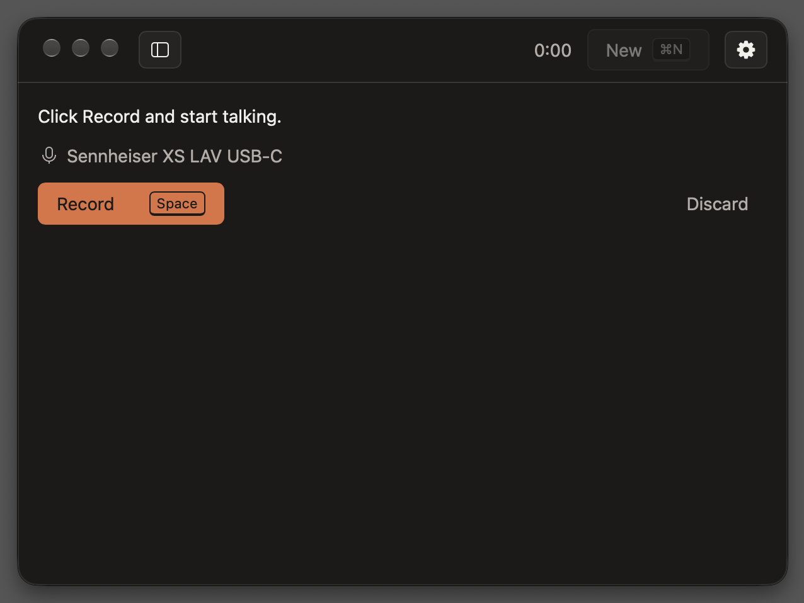
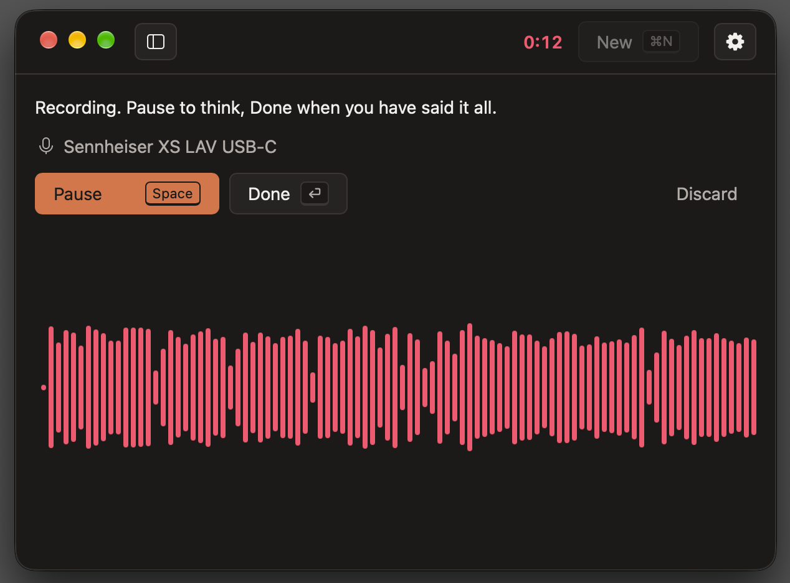
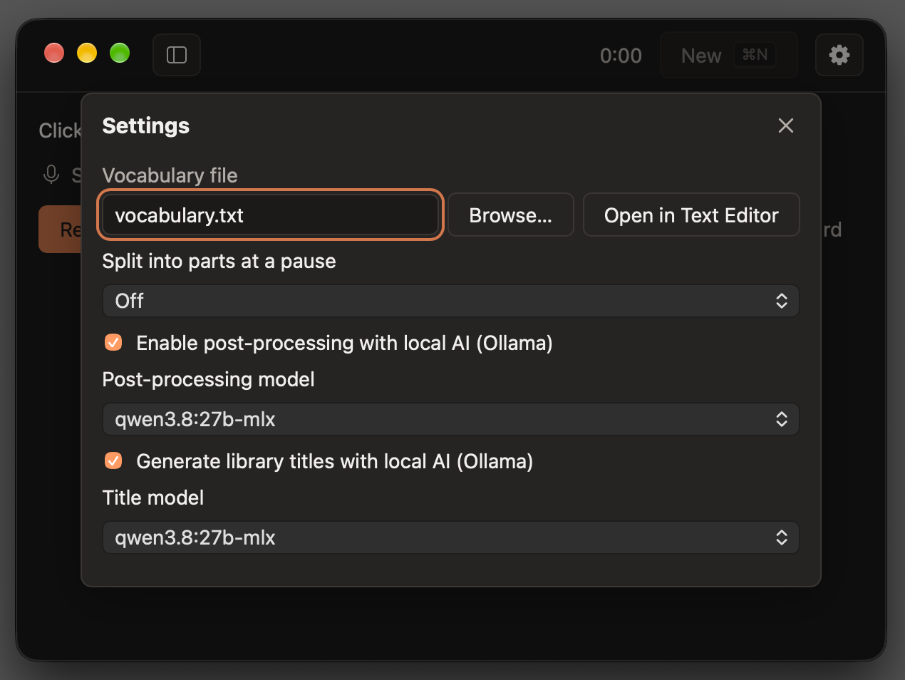
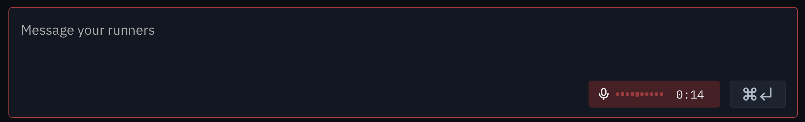

# Scriber

A macOS dictation app built with Rust, Tauri 2 and Svelte 5. Click New, Record, talk, Pause, think, Resume, talk more, then Done: the transcript appears in the window and is already on the clipboard. Transcription is local, with whisper.cpp (`large-v3-turbo`) on the GPU through Metal; nothing leaves the Mac. Every finished dictation is kept in a library, a drawer on the left of the window, titled by when it started, with a short title written by a local model and its audio as M4A. `docs/design.md` has the details.

## Screenshots



Ready to record: the active microphone shows under the prompt, and Space starts recording.



Recording: the live waveform and the red timer show the microphone is on. Space pauses, Return finishes.



Settings: the vocabulary file, automatic splitting at pauses, and the optional local-AI (Ollama) cleanup and library titles, each with its own model.



Here's an example of what you can build with Scriber's crates: dictation inside another app's message box, with its own level meter and timer.

## Prerequisites

macOS with the Xcode command line tools (`xcode-select --install`), then:

```sh
# Rust (the exact toolchain is pinned in rust-toolchain.toml and installs itself)
curl --proto '=https' --tlsv1.2 -sSf https://sh.rustup.rs | sh

# Node and pnpm (the pnpm version is pinned in apps/desktop/package.json)
brew install node pnpm

# Git hooks, commit messages, spelling, secrets
brew install lefthook cocogitto typos-cli gitleaks

# whisper.cpp builds with cmake; the smoke check uses ffmpeg
brew install cmake ffmpeg

# Cargo tools the gate runs
brew install cargo-nextest cargo-llvm-cov cargo-deny cargo-sort cargo-mutants
cargo install cargo-machete
```

## Setup

```sh
lefthook install
cd apps/desktop && pnpm install --frozen-lockfile && pnpm exec playwright install chromium
```

## The speech model

```sh
bash scripts/fetch-model.sh
```

The app downloads `ggml-large-v3-turbo.bin` (1.6 GB) itself the first time it launches without it, showing the progress, and verifies its size and SHA-256 before using it; Record works once it is done. The script does the same from a terminal, into `~/Library/Application Support/com.jasonweddington.scriber/models/`, where the app looks for it. `bash scripts/smoke.sh` then checks the real model end to end: it speaks a sentence with `say`, converts it with ffmpeg and prints what the engine's Whisper adapter hears, with timings.

An optional glossary, `vocabulary.txt` in the same folder (one term per line, `#` comments), steers the spelling of names and jargon.

## The recording library

Each finished dictation with a transcript is kept in `library/<id>/` in the same folder: its transcript, its audio (AAC in M4A, made with macOS's `afconvert`; kept as WAV if that fails) and an `entry.json` with its title (the session's start, `2026-10-26 14:03:09`) and summary. The drawer lists them newest first; select one to read or copy its transcript, and New (or ⌘N) goes back to the recorder. The Library button in the band shows and hides the drawer.

Library titles come from a local [Ollama](https://ollama.com) server, if one is running at `http://127.0.0.1:11434` with the `qwen3.8:27b-mlx` model (`ollama pull qwen3.8:27b-mlx`). Until a title arrives, or when Ollama is not running, an entry shows the first words of its transcript instead. The switch "Generate library titles with local AI (Ollama)" in Settings (the gear) turns titles off for new recordings. Nothing is sent anywhere but that local server.

## Develop

```sh
cd apps/desktop && pnpm tauri dev    # the app, with hot reload
cd apps/desktop && pnpm dev          # the frontend alone in a browser, against the mock backend
bash scripts/gate.sh pre-commit      # the checks every commit runs
bash scripts/gate.sh full            # every check except mutation testing: coverage, audits, e2e
bash scripts/gate.sh release         # full plus mutation testing; release.sh runs it
```

## Install

```sh
bash scripts/install.sh
```

Builds the release app, verifies its signature (ad hoc, so it runs on the machine that built it) and installs it in `/Applications`. The first Record asks for the microphone; allow it in the prompt (or later in System Settings, Privacy & Security, Microphone).

## Release

```sh
./release.sh
```

Derives the next version from the conventional-commit history, sets it in every manifest, writes `CHANGELOG.md`, tags and pushes.

## Using the engine from another Rust app

`crates/scriber-engine` is the whole capability (microphone capture, local Whisper transcription, the model's download and verification) as a library with no Tauri and no async runtime; this app is one client of it. Depend on it from git:

```toml
[dependencies]
scriber-engine = { git = "https://github.com/<owner>/scriber" }
```

Record, then stop and wait for the text. Forward events to a channel: the callback must never call the engine.

```rust,no_run
use std::sync::{Arc, Mutex, mpsc};
use std::time::Duration;

use scriber_engine::{Engine, EngineConfig, Event};

fn run(engine: &Engine) -> Result<(), scriber_engine::EngineError> {
    engine.record()?;
    std::thread::sleep(Duration::from_secs(5)); // the user speaks
    let text = engine.stop_and_wait(Duration::from_secs(60))?;
    println!("{text}");
    Ok(())
}

fn main() -> Result<(), scriber_engine::EngineError> {
    let (tx, rx) = mpsc::channel::<Event>();
    let tx = Mutex::new(tx);
    let events = Arc::new(move |e: Event| {
        let _sent = tx.lock().map(|tx| tx.send(e));
    });
    let engine = Engine::open(EngineConfig::new("/path/to/my-app/scriber"), events);
    // The model downloads (1.6 GB) the first time; rx shows its progress.
    let result = run(&engine);
    let _report = engine.shutdown();
    drop(rx);
    result
}
```

Call `engine.shutdown()` on every path before the process exits: on macOS whisper.cpp's Metal context aborts the process at exit unless the engine is shut down first (dropping the handles is not enough).

The recording library is off by default in the engine; set `EngineConfig::library` to keep finished sessions (and `ollama_url` and `summary_model` to point the summaries elsewhere), then read it with `engine.library()`, `library_transcript(id)` and `library_copy(id)`.

`EngineConfig::model` takes `ModelSource::Local(path)` to use a model file already on disk (nothing is downloaded), or `ModelSource::Download(Source { url, bytes, sha256 })` for a mirror; the default downloads `large-v3-turbo` from Hugging Face. `docs/design.md` (Engine API) has the threading contract and the rest.

## Documentation

- `docs/design.md`: the app's spec and the bridge contract between the webview and Rust.
- `docs/quality-gates.md`: what each gate catches and why it exists.
- `docs/tauri-design-notes.md`: patterns for Tauri 2 apps on macOS.
- `CLAUDE.md`: how an AI coding agent should work in this repository.

## License

Licensed under either of [Apache License, Version 2.0](LICENSE-APACHE) or [MIT license](LICENSE-MIT), at your option. Unless you explicitly state otherwise, any contribution intentionally submitted for inclusion in Scriber by you, as defined in the Apache-2.0 license, shall be dual licensed as above, without any additional terms or conditions.
